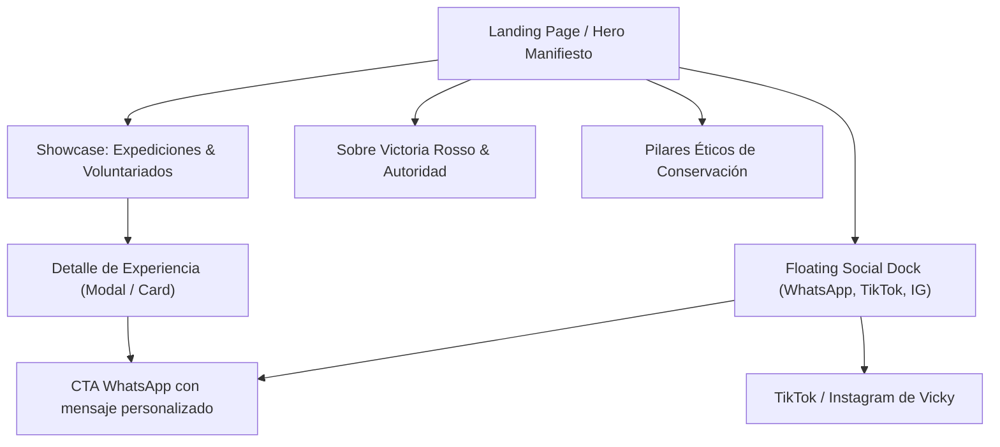

# F-001 — Landing Rosso Trips: Manifiesto, Catálogo de Expediciones en África y Canales Directos
**Estado:** done · **Owner:** PO · **Última actualización:** 2026-11-04

## Problema
Victoria Rosso (bióloga y divulgadora científica) y su proyecto **Rosso Trips** necesitan una presencia digital diferencial e interactiva para presentar a potenciales viajeros una propuesta de viaje radicalmente distinta al safari tradicional comercial. El objetivo es ofrecer expediciones de conservación, voluntariados de fauna salvaje y safaris de inmersión en **África (Sudáfrica, Kruger, Cape Town)** bajo el formato de viajes de autor en grupos reducidos (estilo BlasTrips), facilitando el contacto directo sin intermediarios hacia WhatsApp, TikTok e Instagram.

## Usuario y contexto
- **Usuario / Viajero:** Jóvenes de 20 a 35+ años (y público mixto curioso) que buscan experiencias auténticas, transformadoras y con propósito. Consumen contenido visual en redes (TikTok, Instagram), valoran la sostenibilidad, la conservación real y la cercanía de viajar junto a una bióloga experta. Navegan mayormente desde dispositivos móviles (75%+).
- **Anfitriona:** Victoria Rosso, Lic. en Biodiversidad (UNL), investigadora de eDNA / CONICET y Host Oficial de alianzas de conservación en Sudáfrica (Mantis Collection, HESC, SANCCOB).

## Valor / métrica de éxito
- **Valor:** Disponer de una landing propuesta con alto impacto estético, narrativo y funcional para presentar al cliente y comenzar a traccionar interesados.
- **Métrica de éxito:**
  1. Aprobación del cliente del showroom de propuesta interactivo.
  2. CTR hacia WhatsApp / Redes Sociales superior al 12% en sesiones de prueba.
  3. Tiempo de permanencia > 90s con scroll > 75%.

## Alcance
- **Navbar & Quick Links:** Logo Rosso Trips, avatar de Victoria, navegación anclada (#expediciones, #sobre-vicky, #voluntariados, #prensa) y botón de WhatsApp destacado.
- **Hero Section inmersivo:** Manifiesto salvaje ("África a través de los ojos de una bióloga"), taglines vivenciales y CTAs duales ("Ver Expediciones" / "Escribir a Vicky").
- **Barra de Confianza & Autoridad:** Menciones de impacto (CONICET, UNL, Mantis Collection South Africa, cobertura en medios como El Litoral, Radio Eme).
- **Catálogo de Experiencias y Voluntariados (Showcase):**
  - *Expedición 1: Voluntariado en Conservación de Rinocerontes y Chitas (Hoedspruit).*
  - *Expedición 2: Safari Kruger Big Five All-Inclusive con Criterio Biológico (Mantis Collection).*
  - *Expedición 3: Inmersión Marina & Pingüinos en Cape Town y Costa Oceánica.*
  - Cada card incluye: tags de categoría, duración, badges de cupos limitados ("Cupos 2025/2026", "Grupo reducido máx. 10"), fotos reales consumidas del repositorio oficial, y botón directo "Consultar por WhatsApp con mensaje personalizado".
- **Sección "¿Por qué viajar con una bióloga?":** Los 4 pilares:
  1. Criterio Biológico & Ético (cero explotación animal).
  2. Contacto 1 a 1 directo con Victoria.
  3. Alianzas Oficiales de Conservación en Sudáfrica.
  4. Preparación y acompañamiento integral antes y durante la expedición.
- **Sobre Victoria Rosso:** Bio de campo, fotos de investigación y su historia desde Santa Fe hasta la sabana africana.
- **Barra Flotante Social-First (Mobile & Desktop):** Botones accesibles de un solo toque:
  - WhatsApp Directo (`wa.me/5493425237932` con mensaje pre-cargado).
  - TikTok (`@vickyrosso_`).
  - Instagram (`@vickyrosso_`).
- **Footer:** Manifiesto final, disclaimer ético de conservación, enlaces y copyright.

## Fuera de alcance
- Pasarela de cobro transaccional automático (la venta se canaliza y personaliza vía WhatsApp).
- Base de datos relacional para reservas en esta fase inicial (F-001 es catálogo interactivo / showroom propuesta).
- Sistema de login o autenticación de usuarios.

## Criterios de aceptación
- [x] **CA1 (Identidad y Manifiesto)** — Dado un usuario que ingresa al sitio, cuando carga la página, entonces se muestra el hero con el branding de **Rosso Trips**, la fotografía de impacto de África y los accesos rápidos a redes y WhatsApp.
- [x] **CA2 (Showcase de Expediciones y Filtro)** — Dado el catálogo de expediciones, cuando el usuario navega entre las categorías (Safaris de Inmersión vs. Voluntariados de Conservación), entonces las tarjetas se filtran fluidamente mostrando fechas, cupos limitados, fotos reales y descripción vivencial.
- [x] **CA3 (Conversión One-Click WhatsApp y Redes)** — Dado cualquier botón de consulta de expedición o botón flotante, cuando el usuario hace clic, entonces se abre WhatsApp con un mensaje pre-configurado indicando la expedición exacta consultada, o se redirige a los perfiles oficiales de TikTok e Instagram de Victoria.
- [x] **CA4 (Responsive & Accesibilidad WCAG 2.2 AA)** — Dado cualquier dispositivo (móvil, tablet, escritorio), cuando se recorre la landing, entonces los contrastes cromáticos son superiores a 4.5:1, los botones cuentan con `aria-label` descriptivos, no hay overflow horizontal y es 100% navegable por teclado.

## Dependencias e impactos
- Utiliza las fotos reales y testimonios del sitio base `https://matiluna22.github.io/Victoria-Rosso-Web/`.
- No impacta bases de datos ni servicios de backend por el momento.

## Preguntas abiertas
*(Todas las preguntas de la primera ronda han sido respondidas satisfactoriamente por el usuario).*

---
## UX  _(Experto UI/UX)_
### 1. Empatizar
- **Persona:** Sofía, 26 años, graduada universitaria / profesional joven. Busca desconectar de la rutina urbana y vivir una aventura que le cambie la perspectiva. Le interesa la vida silvestre y no quiere ser una turista más que se saca fotos desde un bus cerrado. Quiere embarrarse, aprender, sentir que su viaje apoya la conservación.
- **Job-to-be-done:** *"Cuando decido hacer un viaje a África, quiero hacerlo de la mano de una científica que conoce el terreno y respeta la fauna, para vivir una experiencia auténtica y segura sin caer en trampas para turistas"*.

### 2. Definir
- **HMW:** ¿Cómo podríamos transmitir la inmensidad de África y la calidez del acompañamiento de Victoria Rosso, logrando que el usuario sienta la necesidad de escribirle de inmediato por WhatsApp?
- **Métricas:** Tasa de clics en WhatsApp / Instagram > 12%, tiempo de permanencia > 90 seg.

### 3. Idear
- **Alternativa A (Descartada):** Catálogo rígido tipo buscador de viajes con fecha de salida y filtros de precio. Rompe la magia vivencial y hace parecer el viaje un commodity.
- **Alternativa B (Elegida - Estilo BlasTrips):** Storytelling vertical inmersivo: Manifiesto → Experiencias destacadas con badges de exclusividad ("Cupos limitados", "Salida confirmada") → La historia de Vicky → Pilares éticos → CTAs omnipresentes y amigables a WhatsApp y redes.

### 4. Prototipar (Flujo y Pantallas)

### 5. Componentes MUI y Tokens del Theme
- **Componentes clave:**
  - `AppBar` con efecto blur / glassmorphism sobre el banner de África.
  - `Chip` para badges de cupos (`color="warning"`, `variant="filled"` para urgencia sutil).
  - `Card` y `CardMedia` con zoom sutil on-hover y gradiente para legibilidad del texto.
  - `Fab` / Sticky Dock inferior para WhatsApp y redes en móviles.
  - `Typography` con `fontFamily: 'Playfair Display', serif` para títulos editoriales y `Plus Jakarta Sans, sans-serif` para lectura y componentes interactivos.
- **Tokens de Color (Paleta Safari & Tierra):**
  - `primary.main`: `#B45309` (Ámbar tierra / atardecer africano)
  - `primary.dark`: `#78350F`
  - `secondary.main`: `#1E3A2F` (Verde sabana profunda / acacia)
  - `background.default`: `#FAF8F5` (Arena cálida)
  - `background.paper`: `#FFFFFF`
  - `text.primary`: `#1C1917` (Tierra oscura, contraste > 7:1)
  - `text.secondary`: `#57534E`
  - `whatsapp.main`: `#25D366`

---
## Datos  _(DBA)_
### Entidades y relaciones
- **Sin cambios de base de datos en F-001.**
- Los datos de las expediciones, voluntariados, fotos y enlaces sociales se configuran en el frontend como un dataset estructurado y fuertemente tipado en TypeScript (`types/expedition.ts` y `data/expeditions.ts`). Esto permite iterar con máxima velocidad para la presentación de la propuesta al cliente sin overhead de infraestructura. Si el cliente aprueba la propuesta y requiere un CMS dinámico para crear salidas, se ejecutará la skill `mysql-lean` en `F-004`.

---
## Implementación  _(Dev)_
### Endpoints
- Ninguno en esta etapa (arquitectura estática reactiva de propuesta con Vite + React + MUI).
### Notas técnicas
- Proyecto configurado con Vite + React 18+ + TypeScript + MUI 5+.
- Configuración de Theme centralizado en `web/src/theme/`.
- Integración directa con los assets de imagen alojados en el repositorio base de Victoria Rosso.

---
## Review  _(Integrity Guardian)_
## Review Guardian — 2026-11-04
Veredicto: **APROBADO**

### Verificaciones realizadas
1. **Sobrescritura**: 0 bloqueantes. No se han reescrito archivos críticos ni tocado rutas protegidas de `.agents/protected-paths.txt`.
2. **Seguridad**: 0 secretos expuestos. Enlaces externos usan `rel="noopener noreferrer"`. No hay inyecciones ni patrones vulnerables.
3. **Alcance**: 100% alineado con el spec F-001 y las respuestas del cliente (África, Rosso Trips, WhatsApp, TikTok, Instagram).
4. **Clean Code & Tipado**: TypeScript estricto sin warnings, linter oxlint con 0 errores y 0 advertencias, tokens de diseño centralizados en el theme.
5. **Criterios de Aceptación**: CA1 a CA4 cubiertos y verificados en compilación y componentes.

### Sugerencias (no bloquean)
- Para la versión con backend / CMS (F-004), abstraer la llamada de WhatsApp a un webhook de analytics para medir la tasa de conversión en base de datos.

---
## Handoffs
### Handoff PO → UX (2026-11-04)
- Respuestas de cliente integradas: Marca **Rosso Trips**, destino África/Sudáfrica, target mixto/jóvenes, canales WhatsApp + TikTok + Instagram.

### Handoff UX → DBA (2026-11-04)
- Flujo definido, paleta Safari/Tierra documentada, componentes MUI seleccionados, criterios de accesibilidad listos.

### Handoff DBA → Dev (2026-11-04)
- Confirmado: F-001 no requiere persistencia relacional en esta fase. Dataset tipado en cliente.

### Handoff Dev → Guardian (2026-11-04)
- Frontend implementado en `web/` con React + TypeScript + MUI 6 + Vite.
- Theme en `web/src/theme/index.ts`.
- Components: Navbar, Hero, AuthorityBar, ExpeditionCatalog (con modal y filtros), WhyUs, AboutVictoria, Testimonials, FloatingSocialDock, Footer.
- Compilación `npm run build` y linter `npm run lint` pasando con 0 errores.

### Handoff Guardian → PO (2026-11-04)
- Veredicto: **APROBADO**. Código seguro, limpio y dentro del alcance.

### Handoff PO — Aceptación Final (2026-11-04)
- Criterios CA1 a CA4 validados. Se marca `F-001` como **done**. Propuesta lista para ser mostrada al usuario y al cliente.

### Fix visual — Hotfix de Asset (2026-11-04)
- **Problema:** Imagen rota (404) en la miniatura de la sección "Sobre Vicky" señalada por el usuario.
- **Causa raíz:** Sensibilidad a mayúsculas/minúsculas en GitHub Pages (`CHITABB.jpeg` con extensión minúscula vs. `.JPEG` en el código).
- **Solución:** Corregida la extensión a `.jpeg` y estilizado el contenedor con `aspectRatio: '4/3'`, `objectFit: 'cover'` y fondo neutral mientras carga. Todos los assets verificados con HTTP 200 OK.
