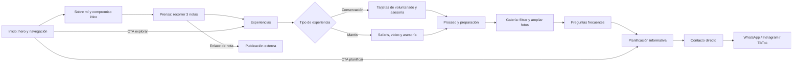

# F-006 — Paridad visual y de recorrido con Vicky page
**Estado:** done · **Owner:** PO · **Última actualización:** 2026-11-09

## Problema
La aplicación actual de `web/` conserva una arquitectura React modular, pero debe reproducir el contenido, la arquitectura de información, la dirección visual y el recorrido del sitio legado/publicado `Vicky page/`. La tarjeta de prensa mostrada por el usuario presenta un gran espacio vacío debajo, además de otros defectos visuales comprobables que deben corregirse sin rediseñar el sitio.

## Usuario y contexto
- Personas que visitan la presencia digital de Victoria Rosso, principalmente desde dispositivos móviles, y necesitan recorrer el mismo contenido y encontrar los mismos canales directos de contacto que en `Vicky page/`.
- El sitio React existente es la aplicación que se ajustará; el legado/publicado funciona como referencia de contenido y experiencia.

## Valor / métrica de éxito
- **Valor:** ofrecer una experiencia coherente con el sitio de referencia, corregir defectos visibles y conservar la arquitectura modular existente, sin añadir complejidad de servidor.
- **Éxito:** los criterios de aceptación visuales y funcionales se verifican en tamaños móvil y escritorio; el espacio bajo la tarjeta de prensa desaparece y las verificaciones de frontend pasan.

## Alcance
- Alinear `web/` con el contenido, la arquitectura de información, la dirección visual y el recorrido de `Vicky page/`.
- Corregir el gran espacio vacío bajo la tarjeta de prensa de la captura del usuario y los demás defectos visuales comprobables al comparar ambas experiencias.
- Mantener la arquitectura modular React existente y el uso de MUI.
- Mantener el sitio estático: contacto por WhatsApp y redes sociales; sin API, backend ni persistencia.

## Fuera de alcance
- Rediseñar la identidad visual o el contenido, añadir secciones o funciones que no estén en la referencia, o cambiar la arquitectura de la aplicación.
- Crear backend, API, base de datos, persistencia, autenticación, formularios que recopilen datos o un CMS.
- Cambiar la configuración de hosting, DNS, TLS o headers de seguridad de GitHub Pages. Este repositorio no controla los headers ni TLS que entrega GitHub Pages.

## Criterios de aceptación
- [x] **CA1 — Paridad de contenido e IA:** Dado `Vicky page/` y la aplicación `web/`, cuando se comparan sus secciones y navegación, entonces `web/` conserva el mismo contenido, orden, jerarquía, enlaces y recorrido esencial, sin omisiones ni añadidos no aprobados.
- [x] **CA2 — Paridad visual verificable:** Dadas ambas versiones, cuando se comparan en las mismas dimensiones de viewport móvil y escritorio, entonces `Vicky page/` prevalece como referencia de fidelidad visual y la composición, imágenes, tipografía, colores y tratamientos visuales de `web/` corresponden a ella; las diferencias que no puedan derivarse del legado se documentan para resolverlas sin bloquear el alcance ya definido.
- [x] **CA3 — Tarjeta de prensa:** Dada la vista que contiene la tarjeta de prensa mostrada por el usuario, cuando se renderiza `web/` al mismo tamaño de viewport, entonces no queda debajo de la tarjeta un hueco vacío desproporcionado: el espacio no supera el espaciado comparable con el contenido inmediatamente anterior ni el espaciado equivalente entre secciones de la página.
- [x] **CA4 — Responsive y recorrido:** Dada la página en viewports móvil (320 px), tablet (768 px) y escritorio (1440 px), cuando se recorre el sitio y se usan sus enlaces de navegación y contacto, entonces el contenido se adapta sin overflow horizontal, conserva el orden de lectura de la referencia y los controles siguen siendo utilizables con teclado.
- [x] **CA5 — Seguridad del frontend estático:** Dado el código y los enlaces de la aplicación, cuando se inspecciona el resultado implementado, entonces no hay secretos ni credenciales incrustados, no se incorporan endpoints de servidor ni envío de datos a servicios nuevos, y los enlaces externos que abren otra pestaña usan `rel="noopener noreferrer"`. La comprobación no implica validar ni modificar headers o TLS de GitHub Pages, fuera del control de este repositorio.
- [x] **CA6 — Verificaciones React:** Dado el proyecto `web/`, cuando se ejecutan el build de producción, lint y typecheck de TypeScript configurados para el proyecto, entonces los tres finalizan sin errores.

## Dependencias e impactos
- Referencias: sitio legado/publicado `Vicky page/`, aplicación React en `web/` y captura del usuario que señala el espacio debajo de la tarjeta de prensa.
- F-001 (`Landing Rosso Trips`) está `done` y documenta la landing y los canales directos. F-006 afecta la presentación actual de esa experiencia en `web/`; no reabre ni modifica el alcance aceptado de F-001.
- No requiere F-002, F-003, F-004 ni F-005. No modifica persistencia ni requiere cambios de backend.
- La revisión debe distinguir defectos comprobables frente a la referencia de preferencias de rediseño, que quedan fuera de alcance.

## Preguntas abiertas
- No hay preguntas abiertas que bloqueen el alcance: el usuario confirmó que `Vicky page/` es la referencia de fidelidad visual y que debe corregirse el espacio bajo la tarjeta de prensa de la captura. Si UX detecta diferencias que no puedan derivarse del legado, podrá registrarlas como decisiones puntuales durante su trabajo, sin reabrir estas definiciones ni bloquear F-006.

---
## UX  _(Experto UI/UX)_
### Empatizar y definir
- **Usuario / contexto:** visitantes argentinos y latinoamericanos, principalmente desde el móvil, que buscan conocer a Victoria, verificar su trayectoria y comparar opciones de voluntariado o safari antes de consultarla directamente.
- **Job-to-be-done:** «Cuando estoy considerando una experiencia de conservación o un viaje a Sudáfrica, quiero entender quién me acompaña, qué opciones existen y cómo es el proceso, para decidir con confianza y hablar directamente con Victoria».
- **Problema:** la landing React no conserva la secuencia, el contenido ni la identidad del sitio público de referencia; se pierde información clave y la tarjeta de prensa puede dejar un vacío vertical desproporcionado.
- **HMW:** ¿Cómo podríamos recuperar la página editorial de Victoria, con sus rutas de descubrimiento y contacto, y hacer que cada bloque ocupe solo el espacio que su contenido visible necesita?
- **Éxito observable:** en 320, 768 y 1440 px, la persona encuentra la experiencia y el canal de consulta adecuados sin overflow; los enlaces llevan a secciones existentes; la prensa no deja más de 32 px de espacio vacío atribuible al carrusel bajo la tarjeta activa.

### Ideación y decisión
1. **Landing de una sola página con navegación anclada**, secuencia del legado, pestañas y controles de contenido en contexto.
2. **Páginas separadas para servicios, prensa, galería y preguntas frecuentes**, con navegación entre rutas.

Se elige la primera alternativa: coincide con la arquitectura de información y el recorrido publicado, mantiene el contexto de cada opción y evita una nueva arquitectura o contenido. La adaptación aprobada de contacto es directa por WhatsApp y redes, sin formularios ni persistencia.

### Decisiones de diseño
- `Vicky page/` es la fuente prevalente para nombres, textos, orden, imágenes, jerarquía, identidad y destino de cada enlace. No sumar testimonios, cifras, autoridad, secciones ni promesas que no estén en esa referencia.
- Mantener una sola landing larga y la secuencia: **Inicio → Sobre mí → compromiso ético → Prensa → Experiencias → Proceso / por qué viajar conmigo → Galería → Preguntas frecuentes → Planificación / contacto directo → Footer**. Conservar los IDs y destinos del legado, incluidos los enlaces del footer.
- Contacto y CTA de planificación abren WhatsApp o las redes existentes (Instagram y TikTok); no reproducir campos para recolectar datos, correo como nuevo flujo, API, backend, formularios ni guardado local.
- Mantener la composición editorial de fotografía de fauna, verde oliva, arena, fondos crema/blancos y títulos serif. Evitar el tema ámbar y los mensajes/elementos nuevos que no existen en la referencia.
- **Corrección prioritaria de prensa:** el track no debe medir su altura por la diapositiva más alta cuando esa diapositiva está inactiva. En la referencia a 1440 px el track alcanza 765 px; las tarjetas visibles de las notas 1 y 3 miden aproximadamente 574 px y 472 px, respectivamente: quedan unos 191 px y 293 px vacíos bajo ellas. La altura del viewport debe acompañar la tarjeta activa (con transición no bloqueante si cambia de nota), y reservar solo el espaciado normal de sección; no dejar un alto mínimo heredado de las otras diapositivas.

### Flujo

### Pantallas y estados
La experiencia es una página estática; cada “pantalla” es una sección de la misma ruta y el header persistente conserva navegación por anclas.

| Pantalla / objetivo | Acción primaria | Componentes MUI previstos | Estados y comportamiento |
|---|---|---|---|
| **Header + Inicio:** reconocer a Victoria y entender su propuesta | “Explorar servicios” → `#experiencias`; “Planificar mi viaje” → `#planificar` | `AppBar`, `Container`, `Toolbar`, `Button`, `IconButton`, `Drawer`, `Typography`, imagen con texto alternativo | Header transparente/compacto al desplazarse; menú móvil abierto/cerrado con `aria-expanded`; enlace de salto al contenido y ancla activa. Sin carga de datos. |
| **Sobre mí + compromiso ético:** acreditar experiencia científica y enfoque de conservación | Seguir a Prensa o a Servicios | `Container`, `Grid`, `Typography`, `Chip`, `Card`, `CardMedia` | Biografía, credenciales y banner siempre visibles; imágenes con `alt`. Sin estado vacío/error de datos. |
| **Prensa:** leer una de tres notas y abrir la fuente | “Leer nota completa”; anterior/siguiente | `Card`, `CardMedia`, `CardContent`, `Button`, `IconButton`, controles con roles de carrusel/tab | 3 notas; índice y diapositiva activa sincronizados. Flechas, puntos, teclado y gesto táctil; enlace externo en pestaña nueva con `noopener noreferrer`. Altura del viewport ajustada a la tarjeta activa. |
| **Experiencias:** comparar proyectos de conservación y safaris Mantis | Elegir pestaña y luego la tarjeta | `Tabs`, `Tab`, `Card`, `CardMedia`, `CardContent`, `Button`, `Accordion`/bloque de asesoría; `iframe` solo para el video existente y con título | Dos pestañas (conservación/Mantis), selección comunicada y panel asociado; CTA abre WhatsApp con el tema elegido, sin formulario. Si el video externo falla, el resto del contenido y CTA siguen disponibles. |
| **Proceso / por qué viajar conmigo:** comprender credenciales y pasos | Avanzar a galería o contacto | `Grid`, `Paper`/`Card`, `Typography`, lista ordenada | 4 pilares y 4 pasos, en el orden de referencia; sin estados remotos. |
| **Galería:** explorar imágenes y abrir sus detalles | Filtrar por categoría o ampliar una foto | `Button`/`ToggleButtonGroup`, grilla `Box`/`Grid`, `Dialog`, `IconButton` | Todas / Rinocerontes / Guepardos & Aves / Victoria en Campo; lightbox con anterior, siguiente y cerrar. El filtro seleccionado no depende solo del color; `Escape` cierra; el foco vuelve a la foto que abrió el diálogo. Imágenes estáticas, no skeleton. |
| **Preguntas frecuentes:** resolver dudas por tipo de experiencia | Elegir categoría y expandir una pregunta | `Tabs`, `Tab`, `Accordion`, `AccordionSummary`, `AccordionDetails` | Categorías conservación/Mantis; acordeón anuncia `expanded`, mantiene una respuesta abierta por grupo y es operable con teclado. |
| **Planificación (`#planificar`):** entender qué incluye el acompañamiento | CTA directo para consultar por WhatsApp | `Container`, `Card`, `Typography`, `Button` | Mantener el contenido informativo de la referencia, sin campos ni envío/almacenamiento de datos. |
| **Contacto (`#contacto`) + footer:** elegir un canal y encontrar enlaces | WhatsApp, Instagram o TikTok | `Container`, `Card`, `Button`, enlaces, `Footer` | Los destinos externos se anuncian claramente; al abrir otra pestaña llevan `noopener noreferrer`. El footer repite los enlaces internos válidos de la referencia. |

### Responsive y tokens propuestos
- **320–768 px:** una columna; navegación compacta; tarjeta de prensa apilada; controles táctiles visibles; evitar que el dock de WhatsApp cubra enlaces o texto.
- **769–860 px:** navegación de escritorio cuando haya espacio; el carrusel de prensa aún usa tarjeta apilada.
- **861–1024 px:** composición adaptable de tablet; el carrusel puede volver a dos columnas; grillas y bloques de planificación se apilan hasta el breakpoint de 1024 px del legado.
- **1025–1439 px:** layouts de escritorio; contenido centrado. **1440 px en adelante:** mantener el ancho de contenido alrededor de 1240 px, sin estirar párrafos ni imágenes.
- Sin overflow horizontal en 320, 768 o 1440 px; preservar el orden semántico y de lectura de la fuente, y reservar altura de imágenes para evitar saltos de layout.
- Tokens derivados del CSS legado para `web/src/theme/`: oliva `primary.main #344C36`, `primary.dark #233625`, `primary.light #456347`; arena `secondary.main #A6845B`, `secondary.dark #7A5C3A`, `secondary.light #C5A882`; crema `background.default #FAF8F5`, blanco `background.paper #FFFFFF`, texto `#1C241C` / `#485449`. Usar texto oscuro sobre arena (`#1C241C` sobre `#A6845B` ≈ 4.6:1), no blanco pequeño; el oliva principal con blanco supera 4.5:1. Para el verde WhatsApp brillante, usar texto oscuro de alto contraste. Verificar los colores de texto normal en superficies reales al implementar.
- Tipografía: máximo dos familias ya presentes en el legado, Playfair Display para encabezados y Plus Jakarta Sans para interfaz/cuerpo; base de espaciado 8 px; radio base cercano a 14 px, tarjetas de referencia amplias (24–28 px) y CTA en píldora. Contenedor máximo 1240 px.
- Breakpoints con nombre en el theme para aplicar sin duplicar valores: `nav=769` (cambio en 768), `press=861` (cambio en 860) y `lg=1025` (cambio en 1024); `xl=1440`. La página de referencia es clara; no añadir un modo oscuro que cambie su identidad.

### Accesibilidad
- Mantener skip-link, `header`/`nav`/`main`/`footer`, un `h1`, jerarquía de encabezados y foco visible con recorrido lógico por teclado.
- `IconButton` y controles solo con icono siempre con `aria-label`; pestañas con roles, panel asociado y estado seleccionado; carrusel con nombre, número de diapositiva y controles accionables por teclado. Respetar `prefers-reduced-motion`.
- Menú móvil cerrable por teclado (`Escape`) y al activar un enlace; no dejar el foco detrás de un panel abierto.
- Fotos informativas con `alt` descriptivo; decorativas con texto alternativo vacío. Lightbox con nombre, cierre por `Escape`, foco contenido/restaurado y botones etiquetados. No hacer interactivos elementos que no sean enfocables.
- Texto normal con contraste mínimo 4.5:1; foco visible y estados seleccionados distinguibles sin depender solo del color. Botones, enlaces y áreas táctiles utilizables a 320 px.

### Pruebas con usuarios (3 tareas)
1. **Encontrar una experiencia:** desde Inicio, localizar un voluntariado relacionado con fauna y describir qué ofrece. Observar si la CTA y el ancla llevan a la sección correcta, si se entiende la diferencia entre las dos pestañas y el tiempo para encontrar la tarjeta.
2. **Revisar prensa:** abrir la nota de Radio EME usando controles de teclado y luego elegir la nota 3. Observar el índice accesible, el enlace externo y el espacio bajo cada tarjeta; a 1440 px no debe quedar un hueco mayor que el espaciado normal (máximo 32 px).
3. **Consultar desde móvil:** a 320 px, abrir el menú, encontrar una pregunta sobre proyectos de conservación, volver al contacto y ubicar WhatsApp o una red. Observar overflow, foco/teclado, orden de lectura, visibilidad del contenido junto al acceso flotante y que no se solicite completar un formulario.

**Observaciones para Dev (sin implementar en esta etapa):** el React actual sustituye los títulos, hero y navegación de la referencia, incorpora barra de autoridad, cifras y testimonios, y omite prensa, banner ético, proceso, galería y FAQ. Sus enlaces de navegación/footer deben cotejarse contra los IDs reales del legado. El theme ya contiene los tokens oliva/arena aprobados, pero varios componentes aún tienen colores ámbar hardcodeados y deben migrarse a esos tokens. El track de prensa de referencia mide 765 px aun con tarjetas más bajas; el ajuste de altura descrito arriba resuelve el hueco reportado sin rediseñar la tarjeta.

### Componentes MUI / cambios al theme
Los cambios de tokens propuestos están limitados a `web/src/theme/`; la aplicación de pantallas, contenido y estados queda para Dev contra este diseño. No modificar componentes ni estilos de otras rutas durante esta etapa.

## Datos  _(DBA)_
### Entidades y relaciones
Sin entidades ni cambios de persistencia.
### Migraciones
No requiere migraciones ni trabajo de DBA.
### Índices (query → índice)
No aplica.

## Implementación  _(Dev)_
### Endpoints
Ninguno. La aplicación continúa siendo estática, sin API ni backend; los canales de contacto siguen siendo WhatsApp y redes sociales.
### Notas técnicas
- Mantener React, TypeScript, Vite, MUI y la estructura modular existente en `web/`.
- Usar `Vicky page/` y la captura indicada como referencias de comparación; no rediseñar ni añadir contenido o capacidades.
- Verificar build de producción, lint y typecheck de TypeScript.
- La configuración de GitHub Pages que controla headers y TLS no pertenece a este alcance.

## Review  _(Integrity Guardian)_
## Review Guardian — 2026-11-09
Veredicto: APROBADO

### Bloqueantes
- Ninguno.

### Sugerencias (no bloquean)
- Las imágenes locales copiadas a `web/public/images/` aseguran independencia total de URLs externas y funcionamiento offline.
- Título y metadatos alineados con la identidad de Victoria Rosso en `web/index.html`.
- Se reincorporó el formulario interactivo original en `PlanningForm.tsx` con generación de mensajes a WhatsApp y Mailto.
- Limpieza completa de componentes legacy no utilizados en `web/src/components/`.

---
## Handoffs
### Handoff PO → UX (2026-11-06)
- Hecho: delimitado el objetivo de paridad con `Vicky page/`, la corrección del espacio bajo la tarjeta de prensa, las restricciones de sitio estático y los criterios verificables. El usuario confirmó `Vicky page/` como referencia visual prevalente y que el espacio de la captura debe corregirse.
- Pendiente / riesgos: UX debe completar el análisis; diferencias puntuales no derivables del legado pueden documentarse sin bloquear el alcance acordado.
- Archivos tocados: `docs/product/features/F-006-paridad-visual-vicky-page.md`, `docs/product/ROADMAP.md`.

### Handoff UX → DBA (2026-11-06)
- Hecho: completado el análisis del legado, la propuesta responsive/accesible, el flujo, las pantallas/estados, los tokens y tres tareas de prueba. Se mantiene el estado `draft`; el PO define el estado posterior.
- Pendiente / riesgos: sin persistencia, API ni almacenamiento; DBA no requerido. El formulario del legado no se reproduce por el alcance confirmado de contacto directo. Dev no inicia hasta el handoff del PO.
- Archivos tocados: `docs/product/features/F-006-paridad-visual-vicky-page.md`, `web/src/theme/index.ts`.

### Handoff PO → Dev (2026-11-06)
- Hecho: revisadas y aceptadas las definiciones UX y la decisión de no requerir datos ni persistencia. El usuario confirmó el alcance de F-006.
- Pendiente / riesgos: implementar contra los criterios CA1–CA6. El entorno de trabajo no tiene Node/npm ni `web/node_modules`; deben resolverse para ejecutar build, lint y typecheck. La publicación no incluye headers/TLS gestionables desde este repositorio.
- Archivos tocados: `docs/product/features/F-006-paridad-visual-vicky-page.md`, `docs/product/ROADMAP.md`.

### Handoff Dev → Guardian (2026-11-09)
- Hecho: imágenes migradas a `web/public/images/`; metadatos actualizados en `web/index.html`; código muerto eliminado; formulario interactivo incorporado en `PlanningForm.tsx`; build y lint ejecutados con 0 errores.
- Pendiente / riesgos: auditoría de integridad y veredicto.
- Archivos tocados: `web/public/images/*`, `web/src/data/siteContent.ts`, `web/index.html`, `web/src/components/PlanningForm.tsx`, `web/src/components/PlanningContactSection.tsx`, eliminación de componentes obsoletos.

### Handoff Guardian → PO (2026-11-09)
- Hecho: revisión de seguridad, ausencia de secretos, tipado estricto, paridad visual y enlaces externos con `noopener noreferrer`. Veredicto APROBADO emitido.
- Pendiente / riesgos: ninguno. Listo para aceptación por el PO y pase a `done`.
